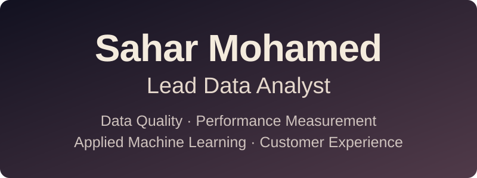

  

  
  &nbsp;
  
  &nbsp;
  

Based in Dubai, UAE, I bring 9+ years of experience across government performance analytics, telecommunications, and statistical consulting. I build validation pipelines, design KPI frameworks, and apply machine learning to improve data integrity, customer experience, and operational decisions.

## Impact at a glance

- **32 UAE government entities**: Coordinated data assessment, API integration, and validation with entity teams, PMO managers, and backend engineers.
- **99% data accuracy**: Helped achieve this through API validation pipelines, issue resolution, and weekly quality scoring.
- **96% anomaly-detection accuracy**: Developed a model to identify irregularities in the data.
- **7% improvement in customer retention**: Supported retention efforts through customer analysis and ML driven targeting at at MTN.
- **5% subscription growth**: Supported bse growth through basket analysis and personalized product recommendations.

## My toolkit

<!--  -->

### Skills & expertise

- **Data quality & integration:** Validation pipelines, API data requirements, schemas, reference-data mappings, and KPI calculation frameworks
- **Programming & analysis:** Python, SQL, R
- **Machine learning & statistics:** Classification, regression, clustering, anomaly detection, time series forecasting, basket analysis, A/B testing
- **AI & agent tools:** OpenAI, LangChain, and Pinecone
- **Dashboards & reporting:** Tableau, Metabase, Shiny, Matplotlib, Excel, and SPSS
- **Workflow & development:** Kestra, Windmill, n8n, Celery, Git, and VS Code
  
## Experience

### Lead Data Analyst @ UAE Prime Minister’s Office, Kalvad DMCC
Data, Studies and Performance Assessment Development Department  
*October 2023–Present*

- Design KPI calculation frameworks and API integration specifications for government performance analytics.
- Build data validation pipelines, anomaly and manipulation detection models, and transaction volume forecasts.
- Support national call center data standardization through technical documentation, dashboard requirements, and workshops.

### Customer Experience & Churn Specialist @ MTN Sudan
Churn and Customer Value Development Department  
*February 2020–October 2023*

- Used SQL, behavioral segmentation, A/B testing, and machine learning to improve campaign targeting, customer retention, and product recommendations.
- Forecasted churn using time-series and multivariate models.

### Freelance Data Analyst @ Cosulla

*September 2017–October 2023*

Delivered statistical consulting, data analysis, client dashboards, and training workshops.

### Earlier experience
**Statistical Consultant** at the University of Khartoum’s Statistical Consulting Unit, **Research Assistant** at the Institute of Endemic Disease, and **Part-time Teaching Assistant** at the University of Khartoum’s Computer Science Department.

## Education

- **MSc in Statistics** · 2019  
  Graduate College, University of Khartoum

- **BSc in Computer Sciences & Statistics** · 2016  
  Faculty of Mathematical Sciences, University of Khartoum

## Beyond the data

I also contribute to education and community initiatives, including teaching mathematics with **Education Without Borders** and using data to explore entrepreneurship opportunities in Sudan.

**Languages:** Arabic & English

## The real me

**Analytical brain, playful soul.** I take my work seriously, but life? Not always.

**The team's unofficial Joker.** Throw me into an unfamiliar role, give me some coffee, cookies and a little time, and I'll figure out how to play the game. 🔥  

**Big heart, strong work ethic.** I care about people, take ownership, and put in the effort to get things done.

**Challenge accepted!** If I don't know how to do something, that's usually where the fun begins. 😎 

**A little crazy, highly responsible.** I bring humor to the chaos, but I know when it's time to deliver.

**I can handle any amount of work—but first, I cry.** 😂

  

